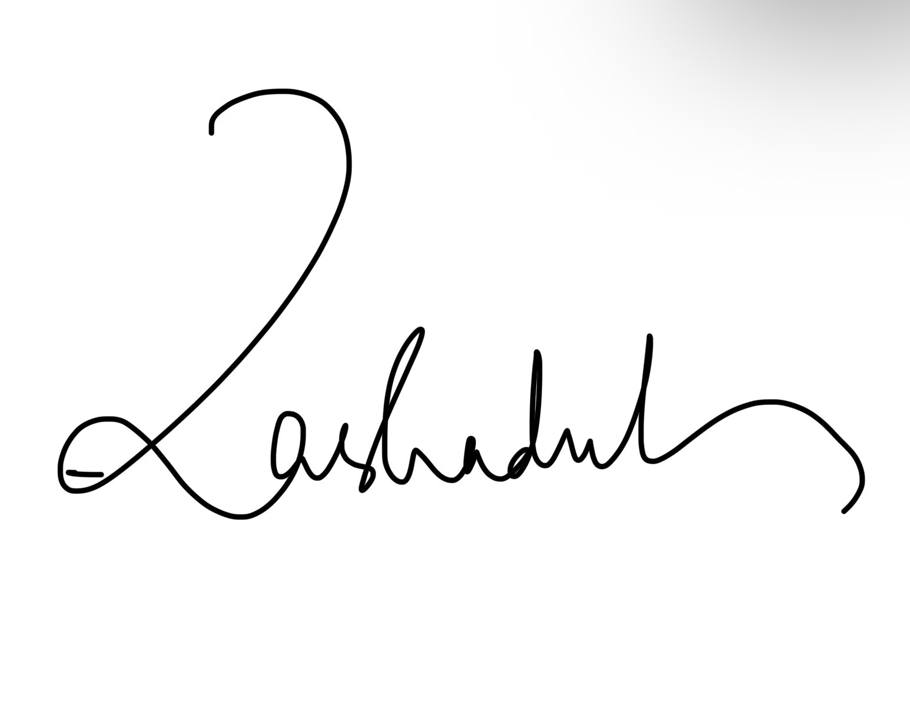

<!-- TOP (1/5): logo left, title right -->
|  | **YOU'RE INVITED TO RESERVE YOUR SEAT** # Release Party # Fedora 45 *Freedom · Friends · Features · First* |
|:---:|:---|

---

<!-- MIDDLE (3/5): the invitation letter -->

## Dear Friend,

It is my pleasure to invite you to the **Fedora 45 Release Party**, a celebration of the newest version of one of the world's most free Linux operating systems, and of the people who build and use it.

### About the project
Fedora is a free and open-source operating system built by a global community and sponsored by Red Hat. It is the proving ground for new technology that later reaches enterprise Linux, so you get the latest desktop, tools and kernel in a polished, reliable form, at no cost.

### Why use Fedora
- **Free, forever:** no licences, no tracking, no lock-in.
- **Always current:** fresh software, with a clear release cycle.
- **For everyone:** Workstation, Server, IoT and Atomic desktops.
- **Welcoming community:** docs, forums and mentors on hand.

### Safe, even when you customize
Fedora is secure by default: SELinux, signed packages and Secure Boot support are on from day one, and apps can run sandboxed through Flatpak. Change the desktop, swap spins or add software, and you stay inside these protections. Mistakes are recoverable: package history can be rolled back, and Atomic editions let you return to the previous system image with one command. Just stick to official repositories and trusted sources.

### What to expect
- Live demos of Fedora 45 highlights
- Install clinic with bootable USB drives
- Short talks and open Q&A
- Customization and security workshop
- Cake, swag and networking
- Contributor sign-up for newcomers

### Who will be there
Students, developers, sysadmins, designers, translators, educators and curious first-timers, along with Fedora contributors and local open-source community members. No experience needed, just bring a laptop and curiosity.

> **Invitation:**
> https://rsvp.fedoraproject.org/releases/f45/checkout/questions/

---

<!-- BOTTOM (1/5): signature and name -->

With warm regards,

**Rasha**
*Fedora 45 Release Party*
